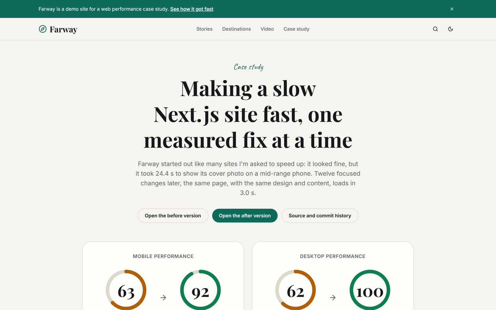
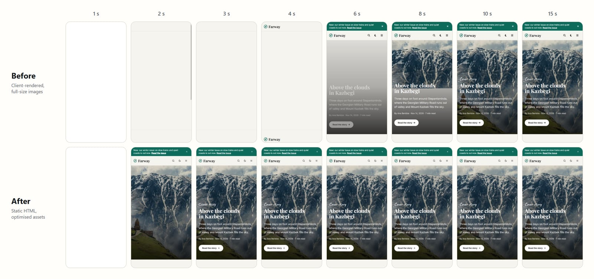
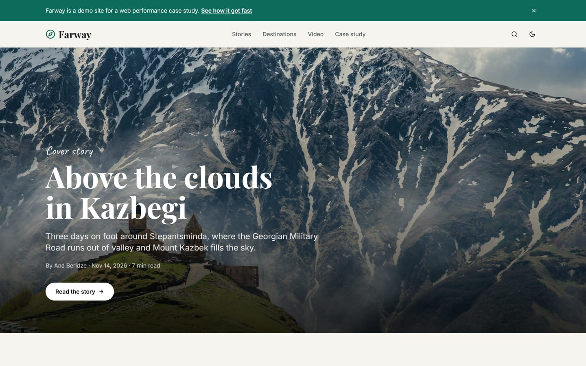
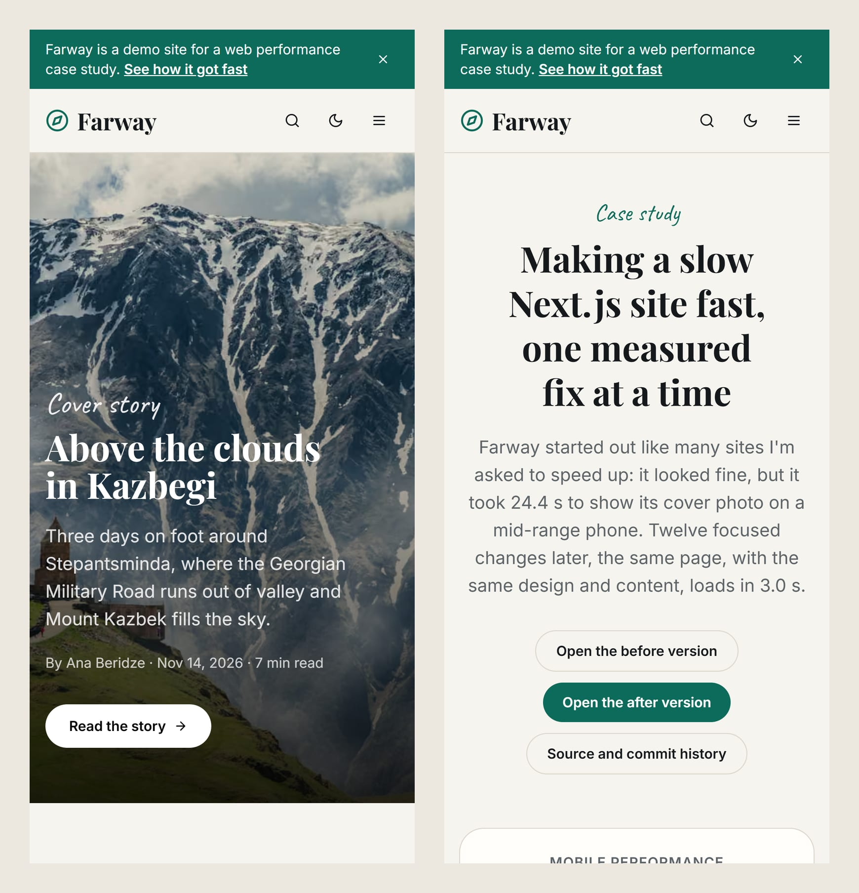
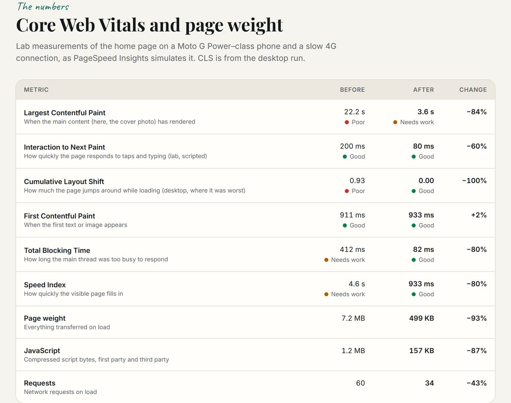

# Farway: a web performance case study

Farway is a fictional travel magazine built with **Next.js 16**, React 19, TypeScript and Tailwind CSS 4. It was first built the way many slow sites are built, then made fast in **twelve measured steps**, one commit per fix. The page looks the same before and after: same design, same content, same photos.

|                  | Before                                                                                      | After                                                                               |
| ---------------- | ------------------------------------------------------------------------------------------- | ----------------------------------------------------------------------------------- |
| Live site        | [farway-perf-before.vercel.app](https://farway-perf-before.vercel.app)                      | [farway-perf.vercel.app](https://farway-perf.vercel.app)                            |
| Mobile score     | **63**                                                                                      | **92**                                                                              |
| Desktop score    | **62**                                                                                      | **100**                                                                             |
| Mobile LCP       | 24.4 s                                                                                      | 3.0 s                                                                               |
| PageSpeed report | [before](https://pagespeed.web.dev/analysis/https-farway-perf-before-vercel-app/hrzvq5a6gk) | [after](https://pagespeed.web.dev/analysis/https-farway-perf-vercel-app/hj8vtzkr81) |

Scores are PageSpeed Insights runs on the live deployments (Lighthouse 13, November 2026). The full write-up, with charts, is on the site: **[farway-perf.vercel.app/case-study](https://farway-perf.vercel.app/case-study)**.



## The starting point

The [`before` branch](https://github.com/datomaluta/farway-perf/tree/before) is deployed exactly as it was measured. Every problem in it is a pattern I regularly find on client sites:

- The home page is a client component that fetches its stories from an API route in `useEffect`, so the first HTML is an empty shell with a spinner
- Every photo is a 2400px JPEG (up to 1.3 MB) in a plain ``, about 5.5 MB of images on the home page
- Three Google Fonts loaded with `display=block` from a render-blocking stylesheet
- Font Awesome's full CSS and icon fonts from a CDN, for fifteen icons
- Leaflet's stylesheet from unpkg, and the map with its tiles loaded on page load
- A YouTube iframe that pulls in about 1 MB of third-party requests
- moment, lodash, react-slick and framer-motion in the bundle
- An announcement bar fetched on the client that pushes the page down when it appears

## Results, step by step

Each row is one commit, built with `next build`, served with `next start` and measured the same way: Lighthouse 13, five runs per form factor, median run kept. Mobile is Lighthouse's default (Moto G Power, slow 4G, 4× CPU), the same emulation PageSpeed Insights uses. INP is measured with a scripted interaction (see [Methodology](#methodology)).

| #   | Change                                                                                                                          | Mobile | Desktop | LCP    | TBT    | CLS (desktop) | INP    | Page weight | JS     |
| --- | ------------------------------------------------------------------------------------------------------------------------------- | :----: | :-----: | ------ | ------ | ------------- | ------ | ----------- | ------ |
| 0   | [Starting point](https://github.com/datomaluta/farway-perf/commit/f2cc18d)                                                      |   62   |   55    | 22.2 s | 412 ms | 0.93          | 200 ms | 7.2 MB      | 1.2 MB |
| 1   | [Serve photos through next/image with responsive sizes and AVIF/WebP](https://github.com/datomaluta/farway-perf/commit/05e4c74) |   67   |   72    | 6.1 s  | 419 ms | 0.93          | 200 ms | 2.0 MB      | 1.2 MB |
| 2   | [Render stories on the server instead of fetching them on the client](https://github.com/datomaluta/farway-perf/commit/4cf0413) |   73   |   97    | 5.4 s  | 218 ms | 0.04          | 184 ms | 2.0 MB      | 1.2 MB |
| 3   | [Self-host fonts with next/font](https://github.com/datomaluta/farway-perf/commit/4fba0e1)                                      |   69   |   97    | 6.3 s  | 253 ms | 0.04          | 184 ms | 2.0 MB      | 1.2 MB |
| 4   | [Replace the Font Awesome CDN with inline SVG icons](https://github.com/datomaluta/farway-perf/commit/bd9674e)                  |   78   |   98    | 4.9 s  | 115 ms | 0.04          | 200 ms | 1.8 MB      | 1.2 MB |
| 5   | [Load the destinations map only when it scrolls into view](https://github.com/datomaluta/farway-perf/commit/95a414a)            |   80   |   99    | 4.5 s  | 117 ms | 0.04          | 192 ms | 1.7 MB      | 1.1 MB |
| 6   | [Replace the YouTube embed with a click-to-load facade](https://github.com/datomaluta/farway-perf/commit/be2e5f5)               |   84   |   99    | 4.4 s  | 83 ms  | 0.04          | 224 ms | 673 KB      | 262 KB |
| 7   | [Replace moment and lodash with Intl and native array methods](https://github.com/datomaluta/farway-perf/commit/117977d)        |   85   |   99    | 4.1 s  | 79 ms  | 0.04          | 240 ms | 629 KB      | 219 KB |
| 8   | [Replace react-slick with a CSS scroll-snap carousel](https://github.com/datomaluta/farway-perf/commit/acb3ce9)                 |   85   |   100   | 4.1 s  | 118 ms | 0.04          | 200 ms | 582 KB      | 204 KB |
| 9   | [Replace framer-motion with CSS and scroll-driven animations](https://github.com/datomaluta/farway-perf/commit/b8b4d56)         |   89   |   100   | 3.6 s  | 53 ms  | 0.04          | 80 ms  | 535 KB      | 157 KB |
| 10  | [Render the announcement bar on the server](https://github.com/datomaluta/farway-perf/commit/08b2be4)                           |   91   |   100   | 3.6 s  | 60 ms  | 0.00          | 72 ms  | 535 KB      | 156 KB |
| 11  | [Load only the font weights the design uses](https://github.com/datomaluta/farway-perf/commit/ade8132)                          |   91   |   100   | 3.5 s  | 48 ms  | 0.00          | 80 ms  | 495 KB      | 156 KB |
| 12  | [Give the cover image high fetch priority](https://github.com/datomaluta/farway-perf/commit/55fc1cd)                            |   90   |   99    | 3.6 s  | 82 ms  | 0.00          | 80 ms  | 499 KB      | 157 KB |

LCP, TBT, page weight and JS are mobile values. Raw results for every run are in [`perf/results`](perf/results), and the full Lighthouse reports for the first and last step are in [`perf/reports`](perf/reports).



_Both versions loading on a phone-sized screen with Chrome throttled to slow 4G and a 4× slower CPU._

### What the numbers say

- **Images were the biggest single win.** Serving responsive AVIF/WebP instead of 2400px JPEGs took the page from 7.2 MB to 2.0 MB and LCP from 22 s to 6 s.
- **Server rendering fixed discovery and layout.** The cover image is in the first HTML response instead of arriving after JavaScript and an API call, and the 0.93 desktop layout shift (spinner swapped for content) disappeared. On paper, First Contentful Paint got later, because the first paint used to be an empty header and a spinner.
- **Not every fix helps on its own.** next/font removed the render-blocking Google Fonts stylesheet and helped desktop, but on slow mobile its three preloaded font files competed with the cover photo and LCP got worse. Step 11 (only the weights in use, decorative font not preloaded) recovered it.
- **Third parties were most of the JavaScript.** The YouTube facade alone cut script transfer from 1.1 MB to 262 KB.
- **INP came from animation, not from data.** framer-motion's layout animations on the filterable archive were the slow part of every filter click and keystroke; with CSS animations INP dropped from about 200 ms to 80 ms.
- **The last step was found on the live site.** PageSpeed Insights flagged that the cover image was requested at low priority (Next.js 16's `preload` prop adds a preload link but no `fetchpriority`). The lab score stays within noise, but the browser now fetches the cover before the carousel photos.

## Methodology

- **Lab runs:** [`scripts/lighthouse.mjs`](scripts/lighthouse.mjs) runs Lighthouse five times with a fresh Chrome for every run and keeps the median run by score. Mobile uses Lighthouse's default config, desktop its desktop preset.
- **INP:** a page load has no interactions, so Lighthouse can't measure INP. [`scripts/inp.mjs`](scripts/inp.mjs) plays the reader's part on the archive (filter by region, type a search, clear it, load more) on a mobile viewport with a 4× CPU slowdown and reads INP with Google's [web-vitals](https://github.com/GoogleChrome/web-vitals) library. It runs Chrome headed, because headless Chrome reports late presentation times on an idle page and inflated INP by several hundred milliseconds in testing.
- **Live runs:** PageSpeed Insights on the two Vercel deployments. Farway has no real visitors, so there is no field (CrUX) data: every number here is lab data.
- **Same build, same machine:** each step was checked out, installed with `npm ci`, built and measured in turn on the same machine. Lab numbers move by a few points between runs; that is why each value is a median of five.

To measure any URL yourself:

```bash
npm run perf:lighthouse -- https://farway-perf.vercel.app --form mobile --runs 5
npm run perf:inp -- https://farway-perf.vercel.app --runs 5
node scripts/summarize.mjs
```

## The site itself

Farway is a complete small site, not just a benchmark page:

- Home page with a cover story, an editor's picks carousel, a filterable and searchable archive of stories and guides, a video, a map of destinations and a newsletter form (a demo: nothing is sent)
- Twelve statically generated story pages with trip guides
- Light and dark themes without a flash, responsive from 360px, keyboard and screen reader friendly controls
- Open Graph images, canonical URLs, `sitemap.xml` and `robots.txt`
- The case study page at `/case-study`, built from the measurement data in `perf/summary.json`



| Mobile (390px)                   | Results table                      |
| -------------------------------- | ---------------------------------- |
|  |  |

## Tech stack

- [Next.js 16](https://nextjs.org) (App Router, static generation, `next/image`, `next/font`)
- React 19, TypeScript
- Tailwind CSS 4
- [Leaflet](https://leafletjs.com) with OpenStreetMap tiles, loaded on demand
- Lighthouse 13, Puppeteer and web-vitals for measurement
- Deployed on Vercel (two projects from one repository: `main` and `before`)

## Getting started

```bash
npm install
npm run dev
```

Then open http://localhost:3000. For measurements, use a production build (`npm run build && npm start`).

## Project structure

```
src/
  app/
    page.tsx               home page (static)
    stories/[slug]/        story pages (generateStaticParams)
    case-study/            the case study page
  components/
    home/                  home page sections
    case-study/            score gauge
    icons.tsx              inline SVG icons
  content/
    stories.ts             stories, guides and photo credits
    case-study.ts          step descriptions; reads perf/summary.json
perf/
  results/                 per-step Lighthouse and INP summaries
  reports/                 full Lighthouse reports, first and last step
  summary.json             merged results used by the case study page
scripts/
  lighthouse.mjs           repeated Lighthouse runs, median kept
  inp.mjs                  scripted INP measurement
  summarize.mjs            merges results into perf/summary.json
```

## Credits

Farway, its writers and its stories are fictional. The photographs are real and come from [Unsplash](https://unsplash.com) under the [Unsplash licence](https://unsplash.com/license):

- Kazbegi: [Iman Gozal](https://unsplash.com/photos/5iQWgow3_S0)
- Norway: [Danny Rienecker](https://unsplash.com/photos/25Bu6uO9xLw)
- Kyoto: [Flora Hon](https://unsplash.com/photos/SNecSSyXxVs)
- Torres del Paine: [martin bennie](https://unsplash.com/photos/fFyIFm0pqNM)
- Positano: [Sebastian Leonhardt](https://unsplash.com/photos/PkWac9CLWVA)
- Iceland: [Joshua Sortino](https://unsplash.com/photos/IlvY3z4KVCI)
- Chefchaouen: [Milad Alizadeh](https://unsplash.com/photos/JibMa0FbyHw)
- Isle of Skye: [Reuben Teo](https://unsplash.com/photos/fUZWpaUknyI)
- Ha Long Bay: [Marina Lobato](https://unsplash.com/photos/kG7pOXbBfNs)
- Lisbon: [Aayush Gupta](https://unsplash.com/photos/ljhCEaHYWJ8)
- Swiss Alps: [Xavier von Erlach](https://unsplash.com/photos/Y_wE4T13uYg)
- Wadi Rum: [Alex Mellado](https://unsplash.com/photos/v7FVGYpXthI)

The video of the week is "The World Outside My Window" by David Peterson, made from NASA imagery, embedded from YouTube. Map data © [OpenStreetMap](https://www.openstreetmap.org/copyright) contributors.
